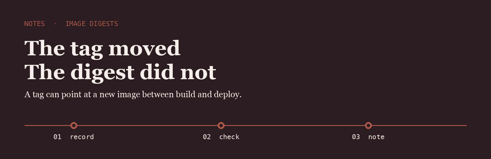
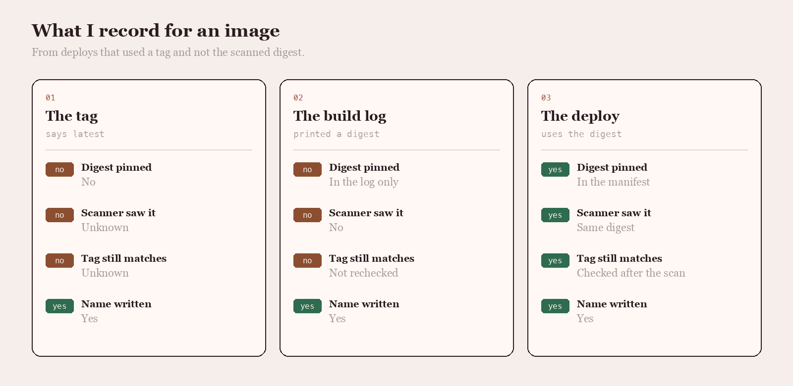

<p align="center">
  
</p>

# Marta Weiss

I record the digest at build time and I refuse a deploy that arrives with only a tag. The scanner has to have seen that same digest.

## The question

Did the deploy use the digest you scanned, or the tag that might have moved?

<p align="center">
  
</p>

|  | The tag | The build log | The deploy |
| --- | --- | --- | --- |
| Digest pinned | No | In the log only | In the manifest |
| Scanner saw it | Unknown | No | Same digest |
| Tag still matches | Unknown | Not rechecked | Checked after the scan |
| Name written | Yes | Yes | Yes |

## The line I keep

The line I write when the deploy digest matches the scan.

```text
2026-06-14  image api  digest sha256:9c1e  tag v1.8.4  scanned  deployed by digest
```

Building the image is solved. Deploying the digest that was scanned is not.

- [go-containerregistry](https://github.com/google/go-containerregistry) is how I read the digest without trusting the tag
- [trivy](https://github.com/aquasecurity/trivy) is the scanner I want aimed at that digest
- [image-spec](https://github.com/opencontainers/image-spec) is the manifest format I check when a digest looks short

I keep a fork of each on this account.

## What I pay attention to

- Deploys pinned to a digest
- Scans of that same digest
- Tags rechecked after the scan
- Manifests I can open

## Working with me

Send a short problem statement, a way to see it happen, and what done looks like. I am independent, remote, and usually around during the Madrid morning.
